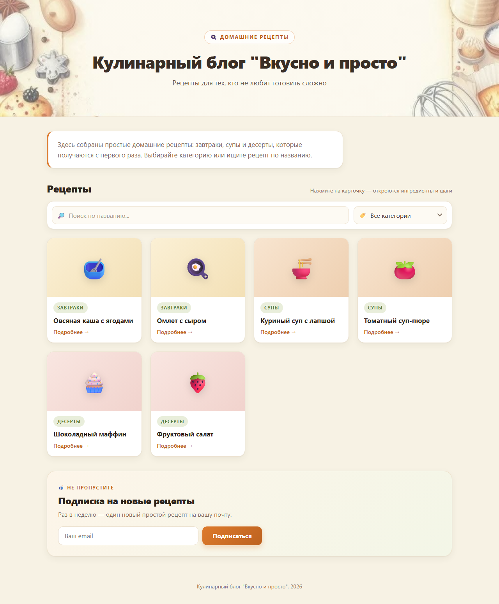
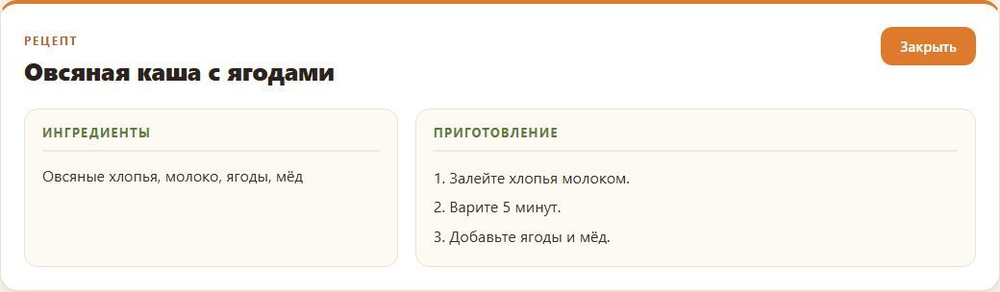

# Кулинарный блог «Вкусно и просто»

Одностраничный кулинарный блог с рецептами домашней кухни: поиск по названию, фильтр по категориям, подробная карточка рецепта и подписка на новые рецепты. Без сборщиков и фреймворков — чистые HTML, CSS и JavaScript, работает как статический сайт.

**[Демо →](https://loparenok01-cpu.github.io/kulinar-blog/)**

## Скриншоты

| Главная: карточки, поиск и фильтр | Карточка рецепта |
| --- | --- |
|  | |

| Подписка |
| --- | --- |
|  |

## Возможности

- **Карточки рецептов** — сетка из шести рецептов (завтраки, супы, десерты) с категорией и эмодзи-медиа
- **Поиск** — мгновенный поиск по названию прямо в списке
- **Фильтр по категориям** — переключение: все, завтраки, супы, десерты
- **Подробности рецепта** — по клику на карточку открываются ингредиенты и пошаговое приготовление
- **Подписка** — форма подписки на email с подтверждением
- **Адаптивность** — корректное отображение на телефонах и десктопе

## Технологии

| Технология | Роль |
|------------|------|
| HTML5 | семантичная разметка одной страницы |
| CSS3 | кастомные свойства, grid/flexbox, градиенты, адаптив через media-запросы |
| JavaScript (ES6) | поиск, фильтрация, открытие карточки рецепта, обработка формы подписки |

Никаких зависимостей, сборки и сервера не требуется.

## Запуск

Откройте `index.html` двойным щелчком в браузере (File → Open) или через любой статический сервер:

```bash
# например, Python
python -m http.server 8000

# или Node.js
npx serve .
```

## Структура проекта

```
.
├── index.html      # разметка: шапка, о блоге, рецепты, подробности, подписка
├── css/
│   └── style.css   # стили и адаптив
├── js/
│   └── script.js   # логика: поиск, фильтр, карточка рецепта, подписка
├── docs/
│   └── screenshots/  # скриншоты для README
└── README.md
```

## Как это работает

- Каждый рецепт описан в разметке атрибутами `data-*` (`data-cat`, `data-name`, `data-ingredients`, `data-cooking`) — JavaScript читает их напрямую из DOM, отдельного файла данных нет.
- Поиск и фильтр работают совместно: применяются одновременно по названию и категории.
- Карточка подробностей — скрытый блок `#recipeDetail`, который заполняется данными выбранного рецепта и плавно прокручивается в область видимости.
- Форма подписки валидирует email средствами браузера (`required`, `type="email"`) и показывает подтверждение без перезагрузки страницы.

## Лицензия

MIT
